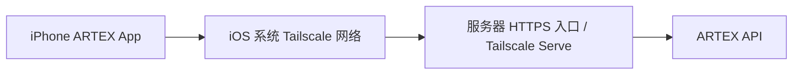

# ARTEX iOS App PRD

版本：v0.5 · 已进入开发（以本文为目标，完成情况见 DEVELOPMENT.md）
日期：2026-11-11
目标设备为 iPhone。工程采用 iOS 26 起的 SwiftUI 原生实现，真机运行需配置开发签名。

## 1. 产品定位与已确认方向

在 iPhone 上连接多个 ARTEX 实例，随时查看、创建和管理 Task，阅读 Findings。任务在远程 ARTEX 服务器上执行，手机承担操作和查看。

已确认需求：

- 支持保存和管理多个 ARTEX 远程源。
- 支持访问通过 Tailscale 连接的 ARTEX 服务器。
- 支持 Task 查看、创建、管理，以及 Findings 查看。
- 支持查看 Task 内的 Sessions，并通过主对话给任务发送 hint、补充信息和追问。
- Sessions 数量可能很多，采用独立列表与详情导航，支持搜索、筛选和分页。
- 使用 iOS 26/27 的 Liquid Glass 设计语言。
- 默认采用较小字号与紧凑排版，提高 Tasks、Findings 与 Sessions 的信息密度。
- **远程源通过左上角切换，不设置独立的远程源底部 Tab。**
- 首次使用时添加自己的 Tailscale HTTPS 源；登录凭据按源隔离。
- 增加可单独撤销的 App Token，90 天到期、闲置 30 天失效；密码改变时失效，iPhone 使用不随备份迁移的 Keychain。

本稿采用的首版默认方案：iPhone 优先、原生界面、中文 UI，底部只有 **Tasks / Findings**。当前远程源是整个 App 的数据上下文；跨源汇总列入后续版本。

## 2. 用户场景与成功标准

| 场景 | 用户期望 | 首版成功标准 |
|---|---|---|
| 外出查看执行情况 | 打开 App 就看到当前服务器上的任务 | 恢复上次选择的源，显示任务状态、最近活动和 Findings 数量 |
| 在两台 ARTEX 间切换 | 不必重复填写地址和登录 | 左上角两次点击完成切换；有效登录会话自动复用 |
| 临时创建任务 | 在手机上填写目标并提交 | 明确提交到哪个源，创建成功后进入对应 Task 详情 |
| 干预任务 | 暂停、继续或整理任务 | 操作结果与服务器一致，网络失败不显示虚假成功 |
| 跟进执行与补充线索 | 查看各 Agent 会话，通过主对话给 Task 发 hint | 能读执行记录、发送消息、看到主 Agent 回复及后续活动 |
| 阅读漏洞发现 | 快速看到严重程度、影响和证据 | 从列表进入完整详情，能追溯所属 Task 与源 |
| Tailscale 连接不可用 | 知道哪里出错，恢复后继续 | 区分网络不可达、认证失效和服务错误；保留编辑内容 |

## 3. 信息架构与页面

```text
┌──────────────────────────────────────┐
│ [● 美国 ARTEX ▾]        Tasks    [+] │
│ 搜索任务                             │
│ 全部  运行中  排队中  已暂停  已结束  │
│                                      │
│ Task 名称                       状态 │
│ 目标摘要 · 最近活动                  │
│ Critical 1 · High 3                  │
│                                      │
│          Tasks       Findings        │
└──────────────────────────────────────┘

点击左上角：
┌──────────────────────────────────────┐
│ 切换远程源                           │
│ ✓ 美国 ARTEX             可连接      │
│   国内 ARTEX             需要登录    │
│   实验环境               未检查      │
│                                      │
│ ＋ 添加远程源                        │
│ 管理远程源                           │
└──────────────────────────────────────┘
```

| 页面 | 主要内容与操作 |
|---|---|
| Tasks | 当前源的任务列表、搜索、状态筛选、新建入口 |
| Task 详情 | 局部导航：概览 / Sessions / Findings；任务操作菜单 |
| Sessions 列表 | 主对话固定入口；可搜索、筛选、分页的会话列表 |
| Session 详情 | 独立阅读页；消息、工具记录与主对话输入区；返回时恢复列表位置 |
| 创建 Task | 当前源、名称、描述、目标与高级选项 |
| Findings | 当前源的发现列表、搜索、严重程度/状态/Task 筛选 |
| Finding 详情 | 摘要、证据、报告、资产、来源 Task |
| 源切换面板 | 源列表、选中状态、连接状态、添加和管理入口 |
| 管理远程源 | 地址、名称、排序、登录、测试连接、移除 |

### 3.1 切换规则

- Tasks 和 Findings 首页的左上角始终显示当前源名称，状态同时使用文字与图标表达。
- 从任意首页切换源后保留当前 Tab，分别恢复该源的搜索、筛选和列表位置。
- Task / Finding 详情始终绑定打开它时的源，并在页面中展示源名称；返回首页后才能切换源，避免详情归属歧义。
- 创建和编辑表单固定绑定进入时的源；要切换源，先保存本地草稿或放弃编辑。
- 切换后立即展示新源的缓存或加载状态；旧源的迟到响应不得覆盖新源页面。
- 一台源不可达不阻止切换其他源。首版不在后台持续轮询全部源；未检查的源不显示为“离线”。
- 首次使用且没有源时，显示“添加远程源”；移除当前源后让用户选择剩余源，最后一个源被移除后返回首次使用页面。

### 3.2 iOS 26/27 设计语言

视觉与交互以 iOS 26/27 原生组件为基线。Liquid Glass 用于浮于内容之上的导航与操作控件；会话消息、工具输出、列表行和报告使用稳定的标准内容表面。文字密集的控件采用 regular 材质，避免过度透明影响阅读。[Apple Materials 规范](https://developer.apple.com/design/human-interface-guidelines/materials)

- 首页使用紧凑标题、左上角远程源切换和底部悬浮胶囊 Tab 栏；主导航保持 Tasks / Findings。Tab 的图标和文字始终可识别。[Apple Tab bars 规范](https://developer.apple.com/design/human-interface-guidelines/tab-bars)
- 默认信息密度为紧凑：原型首页标题 24、详情标题 19、列表标题 13、正文 12–13、辅助信息 11；原生实现以对应 pt 作为默认字号起点，并随 Dynamic Type 缩放。主要通过压缩标题区、行间距和卡片内边距提高密度，不隐藏任务状态、更新时间或 Findings 数量。
- Sessions 单行默认高度约 60 pt，长标题或较大动态字体允许自动增高。触控目标保持至少 44 × 44 pt，输入区保持易于编辑；大字体下允许换行，不以截断关键信息维持紧凑高度。
- Task 内保留概览 / Sessions / Findings 分段；点击会话进入独立详情页，顶部原生返回按钮回到会话列表，不重复显示完整 Task 概览。
- Session 详情提供随键盘上移的底部输入区。工具长输出默认折叠；长记录分页/虚拟化，正文可选中，保持阅读锚点。
- 保持足够大的触控区域、原生返回手势、动态字体、深色模式及 VoiceOver；减少透明度、增强对比度与减少动态效果设置生效后，内容和功能仍完整可用。
- iOS 27 对 Liquid Glass 的可读性与外观调节有进一步改进，原生实现应跟随系统偏好，不固定为高透明效果。[Apple iOS 27 更新说明](https://support.apple.com/en-mide/149076)
- 当前交互原型仅近似呈现材质与布局；系统折射、滚动边缘效果、键盘避让和手势由原生实现与实机验收确认。

## 4. 版本范围

P0 为首版验收范围；P1 为后续功能，不作为首版交付条件。

| 模块 | P0：首版 | P1：后续 |
|---|---|---|
| 多源 | 左上角切换；添加、编辑、排序、测试连接、重新登录、移除；记住当前源 | 配置导入导出、跨设备同步、跨源汇总 |
| Tailscale | 使用系统 Tailscale 连接，支持通过有效 HTTPS 入口访问服务器 | 自动发现节点、嵌入式 Tailscale、HTTP 直连兼容评估 |
| Tasks 查看 | 搜索、筛选、详情、状态、目标进展、最近活动、Findings 数量 | 执行图谱 |
| Sessions 与主对话 | 会话切换、历史记录分页、工具调用与结果查看、实时活动；主对话发送文本/hint、接收回复、停止当前回复 | 附件上传、@ 引用选择器、/btw 旁路问答、Worker 直接发消息、新建主会话 |
| Tasks 创建 | 指定源、名称、描述、目标；继承服务器默认配置；本地草稿 | 任务模板、附件、测试账号、复杂继承与范围规则编辑 |
| Tasks 管理 | 暂停/继续、重命名、置顶、复制基本配置新建、删除 | 分类管理、批量操作、归档/恢复、运行配置调整 |
| Findings | 列表、筛选、详情、Markdown 报告、文本证据、来源 Task | 状态修改、复测、深化分析、报告导出、完整流量证据浏览 |
| 更新与提醒 | 前台刷新、回到前台刷新、缓存状态提示 | APNs 推送、Widget、后台刷新优化 |

首版不承诺执行完成的后台实时推送；关闭 App 不影响服务器上已创建的 Task 继续执行。

## 5. 远程源管理与 Tailscale

### 5.1 源配置

| 字段 | 规则 |
|---|---|
| 显示名称 | 必填，可修改，例如“美国 ARTEX” |
| 服务地址 | 必填，完整 HTTPS Base URL；示例 `https://artex-us.<tailnet>.ts.net`，其中 `<tailnet>` 为占位符 |
| 连接说明 | 可选，例如“通过 Tailscale 访问”；用于帮助排查，不代表已检测到 VPN 状态 |
| 认证 | 使用该 ARTEX 实例的账号与密码登录；首版登录页预填现有后端账号 `ARTEX` |
| 排序 | 可调整，切换面板与管理列表顺序一致 |
| 连接信息 | 最近检查时间、最近成功时间、服务器版本、最近错误摘要 |

保存配置允许暂时不可达，显示“待验证”。“连接成功”必须同时通过服务识别、登录和受保护的只读 API 检查，不能仅凭 HTTP 200 判定。

每个源独立保存登录会话。更换服务地址须重新验证身份并清理原地址对应缓存，旧凭据不能自动发送给新地址。移除源会清除该源的本地配置、凭据、草稿和缓存，不删除服务器数据。

### 5.2 推荐连接方式



首版依赖用户在 iPhone 上安装并连接官方 Tailscale App。App 使用系统网络访问 ARTEX，不管理 Tailscale 账号、VPN 开关或访问策略。官方 iOS 客户端负责安装 VPN 配置及登录。[Tailscale iOS 文档](https://tailscale.com/docs/install/ios)

推荐以完整 MagicDNS 域名作为入口，通过 Tailscale Serve 将 HTTPS 请求转发到服务器本地 ARTEX 端口。Serve 可代理本地服务，并受 tailnet 访问策略约束。[MagicDNS 文档](https://tailscale.com/docs/features/magicdns)、[Tailscale Serve 文档](https://tailscale.com/docs/features/tailscale-serve)

接入条件：

- 手机当前 Tailscale 网络能够访问目标服务器，相关访问策略允许连接。
- 服务器提供有效 HTTPS 入口，证书与填写的主机名匹配。
- 通过 ARTEX 自身的认证；Tailscale 网络连通不替代 ARTEX 登录。
- 多个已保存源可以属于不同网络，但只能连接当前系统网络实际可达的源；App 不自动切换 tailnet。
- 支持有效 HTTPS 域名入口；IP 地址入口仅在证书校验通过时可用。不通过“忽略证书错误”解决连接问题。HTTPS 默认方案符合 Apple ATS 的连接要求。[Apple ATS 文档](https://developer.apple.com/documentation/security/preventing-insecure-network-connections)


### 5.3 连接错误的用户反馈

| 情况 | 界面行为 |
|---|---|
| 地址格式不正确 | 在地址字段直接提示，保留输入 |
| DNS 解析失败 / 连接超时 | 显示实际失败阶段；提示检查 Tailscale、地址和访问策略，不直接断言“VPN 未开启” |
| TLS 校验失败 | 显示证书问题，阻止登录和发送凭据 |
| ARTEX 登录失效 | 仅当前源显示“需要登录”，保留草稿，其他源会话不受影响 |
| 403 / 服务端拒绝操作 | 展示服务器返回的原因；不统一当作登录过期 |
| 服务返回 HTML 或非 ARTEX 响应 | 提示“该地址不是可直接访问的 ARTEX API”，说明可能指向额外登录网关 |
| 服务器版本不兼容 | 显示受影响功能与原因，已兼容的查看功能继续可用 |

## 6. Task 查看、创建与管理

### 6.1 列表与详情

列表每项包含：名称、状态、目标或描述摘要、最近活动时间、Findings 严重程度计数。置顶任务优先，其余默认按最近活动倒序；无活动时使用创建时间。

支持按名称、描述、Task ID 搜索，并按状态筛选。详情展示目标原文、描述、创建/完成时间、目标完成数量、运行中 Worker 数量、Token 用量、最近活动及关联 Findings。缺失数据使用“暂无”，不虚构进度百分比；目标完成数量不等同于整个任务的完成百分比。

服务端状态显示为：`created` 已创建、`queued` 排队中、`running` 运行中、`paused` 已暂停、`done` 已完成、`failed` 失败、`timeout` 超时。未知状态展示服务端原值，并停用无法确定适用性的控制操作。模型不可用等执行异常单独提示，不自行改写任务状态。

### 6.2 创建 Task

流程：Tasks 点击“＋” → 填写表单 → 点击“创建并执行” → 成功后进入新 Task 详情。

| 字段 | 首版规则 |
|---|---|
| 远程源 | 显示当前源名称与地址，表单内固定 |
| 任务名称 | App 侧必填，最多 200 个字符 |
| 任务描述 | 可选；未填写时使用名称提交为描述 |
| 任务目标 | 必填，多行文本；写明目标对象、工作内容和约束，展示服务端校验错误 |
| 超时时长 | 高级选项，可选；默认沿用后端无时限语义，界面明确显示 |
| 模型及执行配置 | 首版继承当前服务器默认值；不要求在手机配置 API Key |

关键行为：

- 创建会触发远程执行或进入服务器队列，按钮使用“创建并执行”，不使用含糊的“保存”。
- 本地草稿与源绑定；未提交草稿不会创建远程任务，也不会占用服务器队列。
- 提交期间禁用重复点击。只有收到创建成功响应并取得 Task ID 才显示“创建成功”。
- 提交后断网或超时，显示“提交结果待确认”，保留提交信息，刷新任务列表供核对；不自动重发创建请求。
- 首版目标与约束以文本提交；不把目标文字描述为已配置的强制执行范围。需要结构化范围/拦截规则时，作为后续创建能力单独实现。

### 6.3 管理动作

| 动作 | 适用条件 | 产品行为 |
|---|---|---|
| 暂停 | 非终态且尚未暂停 | 提交后等待服务端确认；排队中任务也可暂停 |
| 继续 | 已暂停 | 以服务端返回为准，可能进入运行中或排队中 |
| 重命名 | 任务仍存在 | 修改名称，不修改原始目标和描述 |
| 置顶/取消置顶 | 任务仍存在 | 保存到该源，重新加载后仍有效 |
| 复制基本配置新建 | 可读任务 | 复制名称、描述和目标到当前源新建表单；不复制结果、凭据、继承关系或完整运行配置 |
| 删除 | 首版界面限已暂停或终态任务 | 确认框展示源与任务名称；调用删除后以服务器结果为准 |

已完成、失败、超时任务不展示“继续”；如需独立重跑，使用“复制基本配置新建”。现有任务控制 API 支持暂停和继续。主对话属于另一种干预方式：主 Agent 新增目标等操作可能重新激活原任务，具体以服务器状态为准，见 6.5。

删除默认显式保留独立 Findings、资产、流量、文件和 LLM 记录，不提供级联清理选项。确认文案说明任务及其执行上下文会被删除，保留的 Finding 可能不再能打开原 Task；服务器返回的清理警告必须展示。若源版本无法确认这些删除语义，则停用删除入口。

操作与网络行为：

- 同一个 Task 的写操作串行提交，操作中提供进度状态。
- 服务端拒绝、任务已删除或状态已变化时，展示原因并刷新详情。
- 超时后先查询当前状态，不把请求超时当作操作一定失败。
- 切换源或退出页面不会撤销已发送的操作；结果仍归属原源，不能显示到新源任务上。

### 6.4 Sessions 查看

Task 内提供 **概览 / Sessions / Findings** 三个局部入口，App 底部仍保持 Tasks / Findings。进入 Sessions 先显示完整会话列表，主对话固定在首位。点击一项进入独立 Session 详情；顶部“返回 Sessions”恢复搜索条件、分页进度和阅读位置。会话切换不使用下拉菜单，也不将长会话列表放进小型弹层。

会话列表规则：

- 当前主对话固定为快捷入口，支持随时进入给 Task 发消息/hint；列表其余部分按执行中、最近结束、历史主会话/系统等分组，避免重复列出当前主对话。
- 支持标题、Session/Intent ID 搜索，以及角色、运行状态筛选。搜索涵盖匹配的全部分页数据，不能只搜首屏却显示为完整结果；主对话快捷入口与搜索结果明确分开。
- Worker 按服务端游标分页，首屏先返回可用数据；加载更多保留已加载内容，失败可重试。滚动时不持续重排当前可见行；新活动通过未读/更新提示呈现。
- 每行展示会话标题、类型、状态、最后活动和未读数；长标题允许两行显示。列表空态区分无会话与没有搜索结果。
- 原生列表采用懒加载/复用；从详情返回恢复同一行附近的位置。当前源、Task、搜索条件和分页游标共同定义列表上下文。

| 会话类型 | 首版内容 | 交互 |
|---|---|---|
| 主对话 Main Agent | 用户消息、Agent 回复、操作记录、已返回的工具调用与结果 | 支持发送消息；可切换并继续历史主会话分段 |
| Planner | 规划记录、决策摘要、工具调用与执行结果 | 只读，可回到主对话补充 hint |
| Worker | 每个执行会话的标题、状态、关联 Intent、消息与工具结果 | 只读，提供“给主对话发 Hint”入口 |
| 系统事件 | 调度、模型切换、错误及其他任务事件 | 只读 |

- 会话状态与 Task 状态分别显示，主 Agent 空闲不代表整个任务已完成。
- 默认加载当前会话最新一页；向上加载更早记录，保留阅读位置。工具参数、返回内容和长文本按需展开，不一次加载所有日志。
- 前台接收新活动；用户正在阅读历史时不强制滚到底部，显示“有新消息”。重连后补齐历史并去重。
- 明确区分“暂无记录”“正在加载”“加载失败”“记录不可用”；失败不展示成空会话。
- 继承/关联 Task 的会话如服务端允许读取，应显示原始来源，保持只读；不能仅因 Intent ID 相同就复用其他源或任务的内容。

### 6.5 主对话与 Hint

输入区位于主会话底部，随系统键盘上移，显示发送目标“当前源 · Task #ID · 主对话 #分段”。支持多行文本、编辑草稿和发送；换行不触发发送。快捷提示“补充线索 / 调整重点 / 询问进展”仅填入可编辑文本，用户点击发送后才提交。

示例：“Hint：请优先关注订单接口的对象归属校验，并结合已有 Findings 避免重复验证。”普通提问与 hint 共用 Task 主对话入口，由服务端主 Agent 理解和执行；手机端不把任意消息直接转换成全局指令或 Worker 指令。

发送与反馈规则：

1. 消息必须携带当前源、明确的 Task ID 和主会话分段 `seg`。切换 Task、源或分段时草稿分别保存；阅读 Worker 时不在 Worker 页直接发送主对话消息。
2. 区分“发送中”“已接收，处理中”“已回复”“发送失败”“结果待确认”。HTTP 202 只代表服务端接受；看到 Agent 回复或实际工具/任务事件后，才能显示相应处理结果，不能把“已发送”标为“hint 已生效”。
3. 服务端按 Task 串行处理主 Agent 轮次，历史主会话分段之间共享忙碌状态。处理中允许编辑下一条草稿，但禁用再次发送；409 冲突保留草稿并同步服务端状态，不自动排队重发。
4. “停止回复”只终止当前主 Agent 轮次，不暂停整个 Task，也不撤销已完成的工具操作；按钮显示“正在停止”，确认空闲后恢复发送。
5. Task 已暂停仍可以发送主对话消息；暂停动作会中止当时正在执行的主 Agent 轮次。发送消息本身不等同于点击“继续”，但主 Agent 新增目标等操作可能重新激活已暂停或终态任务，界面必须同步新的真实状态。
6. 运行中、排队中、已暂停和终态 Task 的发送资格，以服务端任务存在、模型可用、当前轮次空闲和权限为准；已删除或已归档且不再可操作的 Task 仅保留可获得的历史内容。
7. 弱网或请求超时后先补拉历史与 `chat/status` 核对，不自动重发。现有主对话接口未核实支持客户端幂等消息 ID，无法确认是否接收时保留文本并提示核对；文本相同不能作为可靠去重依据。
8. 关闭页面、切换源或 App 进入后台，不自动停止已被服务器接受的对话轮次。回到页面后补拉记录；流连接断开与主 Agent 执行失败分别提示。

首版提供主对话发送与会话阅读完整闭环；新建主会话、附件、@ 选择器、/btw 和 Worker 直接发消息暂列后续。此处的“主对话”始终指 Task 内 Main Agent，会话不会发送到 ARTEX 全局独立聊天页。

## 7. Findings 查看

### 7.1 列表

默认展示当前源 Findings，按严重程度优先排序；支持切换为时间排序。列表项包含名称、严重程度、处理状态、摘要、关联资产、所属 Task 和发现时间。

支持关键词、严重程度、处理状态和 Task 筛选，提供分页加载与下拉刷新。从 Task 详情进入时默认限定该任务；进入底部 Findings Tab 时恢复该源上次筛选条件。

严重程度沿用现有后端 `critical / high / medium / low`；处理状态沿用 `pending / in_progress / confirmed / resolved / fixed / false_positive / ignored / duplicate / risk_accepted`。未知值保留并可读，不因新增枚举导致页面失败。

### 7.2 详情

- 展示名称、漏洞类型、严重程度、处理状态、摘要、时间与来源信息。
- 展示受影响资产、文本证据和 Markdown 报告，支持选中与复制文本；代码块支持横向滚动。
- 报告不存在时显示“暂无报告”；后端标记报告证据已过期时，显示“报告尚未包含最新证据”。
- 若发现来自继承任务，标明原始来源；原任务已删除或归档时保留 Finding 内容，说明任务详情不可用。
- 首版展示关联流量数量，但完整请求/响应与附件浏览列入后续。
- 远程 Markdown 按内容渲染，不执行脚本；外部链接由用户主动打开，不自动加载外部图片或携带 ARTEX 凭据。
- Findings 首版只读，不提供状态修改、删除、复测或运行代码的操作。

## 8. 刷新、缓存与数据隔离

- 初始建议：当前源任务列表每 15 秒刷新，运行中的 Task 详情每 5 秒刷新，Findings 列表每 30 秒刷新；均支持手动刷新。频率在实机联调后按流量和耗电调整。
- Sessions 使用当前 Task 的活动 SSE；先读取分页历史的 `snapshot_cursor`，再衔接实时活动，按 `seq` 去重。网络恢复时从已确认游标补齐，必要时重新读取快照；主 Agent 忙碌状态使用 `chat/status` 校准，不根据“几秒没有消息”猜测已结束。
- 仅当前可见页面执行定时刷新；App 回到前台立即刷新当前源。iOS 会限制后台执行，因此不以后台常驻连接作为首版实时性保证。[Apple 后台执行文档](https://developer.apple.com/documentation/uikit/extending-your-app-s-background-execution-time)
- 缓存最近一次列表及最近打开的详情，注明更新时间；离线数据可阅读，远程写操作不可用，新任务可保存本地草稿。
- 不创建离线写操作队列；网络恢复后不自动创建、暂停、继续、删除任务或补发聊天消息。聊天草稿按源、Task、主会话分段隔离，实时响应不能覆盖正在编辑的草稿。
- 本地以“源 ID + 对象类型 + 对象 ID”识别数据。两台服务器都存在 Task #52 时，必须始终区分。
- Token 存入 Keychain 并按源隔离，密码默认不持久保存；草稿和缓存使用系统文件保护，默认不做跨设备同步。提供本地缓存清理入口。
- 首版不加入第三方行为统计；调试日志不记录密码、Token、证据正文或完整任务目标。

## 9. 现有接口与实现约束

以下基于工作区 `ARTEX` 的当前代码，HEAD 为 `a9c7a75`；这是本地接口基线，不代表所有远程源已经部署相同版本。实施前对目标实例进行只读兼容检查。

| 能力 | 已核实接口/代码行为 | iOS 侧要求 |
|---|---|---|
| 服务识别 | `GET /api/health` 返回 service、version、ok | 验证 `service=artex`；health 成功不等于认证成功 |
| 登录 | `POST /api/auth/login`；Bearer JWT；当前有效期 7 天 | 按源持有 Token；过期重新登录，不假定存在 refresh token |
| Task 列表/详情 | `GET /api/tasks`、`GET /api/tasks/{id}` | 列表当前全量返回，首版本地搜索筛选 |
| 创建 | `POST /api/tasks`，创建后调用执行启动逻辑 | 使用“创建并执行”；没有已核实的请求幂等键支持 |
| 名称/置顶 | `PATCH /api/tasks/{id}` | 不承诺原始 description / goal 可编辑 |
| 暂停/继续 | `POST /api/tasks/{id}/control`，action 为 pause / resume | 终态不可通过 resume 重新执行 |
| 删除 | `DELETE /api/tasks/{id}`，可指定保留/删除关联数据 | 显式发送保留选项，处理 cleanup warning |
| 最近活动 | `GET /api/exploration/activity` 等 | 查询显式传入所属 Task，联调确认参数和分页 |
| 主会话分段 | `GET /api/exploration/main-sessions?task={id}` | 保存分段 seq；当前后端允许在历史分段发消息，不依据旧前端注释误判为只读 |
| Worker 列表 | `GET /api/exploration/intents?task={id}&page=1&before=…&limit=…` | 分页加载，避免固定条数截断 |
| 跨页会话搜索与筛选 | 当前客户端可组装各类会话；全量关键词/状态筛选接口尚未核实 | 实施时补齐服务端会话索引或等效查询；仅搜索已加载数据的兼容模式须明确标注，不冒充完整搜索 |
| 会话历史/详情 | `GET /api/exploration/activity/history?task={id}&session=…&before=…&limit=…`；`GET /api/exploration/activity/{seq}?task={id}` | session 如 `main:2`、`plan`、`intent:17`、`system`；长详情按需读取 |
| 实时活动 | `GET /api/exploration/activity/stream?task={id}&since=…` | 衔接历史快照，按会话分发与去重；连接随当前源和 Task 切换 |
| 主对话发送 | `POST /api/chat?task={id}`，body 为 `message`、`seg` | LLM 模式返回 202 accepted，回复从活动流获得；兼容 200 rule-mode 响应 |
| 主对话状态/停止 | `GET /api/tasks/{id}/chat/status`；`POST /api/tasks/{id}/chat/stop` | busy 为整个 Task 共享；stop 只停止当前主对话轮次 |
| Findings 列表 | `GET /api/exploration/findings?page=…&limit=…` | 使用分页接口；Task 过滤使用 `task_id` |
| Finding 详情 | `GET /api/exploration/findings/{id}` | 使用独立 finding ID，不能混用任务节点 ID |
| 归档/恢复 | 已有 `/api/task-archives` 及相关操作 | 后续版本接入，处理异步状态与依赖阻塞 |

需要特别遵守的接口边界：

1. **查看 Task 不调用 `POST /api/active`。** 当前实现会更新服务器全局活动任务，并可能运行引擎；移动端查看应使用明确 Task ID 的只读请求。
2. Findings 的 `task` 与 `task_id` 参数语义不同。前者走任务节点视图，当前有数量上限；后者筛选独立 Findings 表。首版任务内列表采用后者分页，只显示该任务自己的发现，继承发现聚合后续实现。
3. 不从只读 GET 失败推断写接口不存在，也不通过创建/删除真实任务来探测能力。版本兼容表与非破坏性读请求结合；有条件再增加 capabilities 接口。
4. 请求去重仅靠手机端不能保证服务端“恰好创建一次”。若后续要求超时后安全重试，需要后端增加幂等键和结果查询能力。
5. Task 全量列表可能成为大实例的性能瓶颈。达到首版数据规模目标前先实测；超出目标时优先补后端分页，不在手机端无限堆积数据。

建议实现基础：SwiftUI、URLSession、Keychain、本地文件/数据库缓存。视觉和实机验收平台以 iOS 26/27 为基线，最低支持版本在开发前确认；如保留旧系统兼容，单独定义材质降级方案。App 直接访问各远程源，首版不引入额外业务中转服务器。

## 10. 验收清单

以下为完整验收目标；执行结果与尚未覆盖的场景见 DEVELOPMENT.md，不等同于全部验收通过。

| 编号 | 验收场景 | 预期 |
|---|---|---|
| A01 | 添加两台 ARTEX，并从左上角切换 | Tasks / Findings 同步切到选中源；底部始终只有两个 Tab |
| A02 | 两个源均有相同 Task ID / Finding ID | 页面、缓存、操作和详情跳转不串源 |
| A03 | 切换源时旧请求延迟返回 | 新源页面不被覆盖；原源写操作仍准确归属 |
| A04 | 通过 Wi-Fi 和蜂窝网络访问 Tailscale HTTPS 入口 | 可登录、读列表、创建任务；切网后可恢复刷新 |
| A05 | Tailscale 不可达、域名解析失败、证书错误 | 分类提示；不误报任务失败，不发送凭据到无效 TLS 连接 |
| A06 | 单个源 Token 失效 | 只要求该源重新登录，其他源正常，表单草稿保留 |
| A07 | 创建成功、进入队列、校验失败 | 分别显示真实结果；失败时保留填写内容 |
| A08 | 创建请求已送达，但响应丢失 | 显示结果待确认，不自动重发或虚构 Task ID |
| A09 | 暂停/继续，以及 Web 端同时改变状态 | 以服务器最新状态为准；终态不出现继续按钮 |
| A10 | 仅打开 Task 详情 | 不改变服务器全局 active task，不触发执行 |
| A11 | 删除任务并保留 Findings | Task 消失，保留的 Finding 可查看，失效 Task 入口有说明 |
| A12 | Findings 分页、搜索、严重程度和 Task 筛选 | 数据完整翻页；不受任务节点接口的 200 条上限误导 |
| A13 | 空报告、长代码块、未知枚举、报告过期 | 页面可阅读，有对应提示，不崩溃 |
| A14 | App 进入后台、离线、再回前台 | 服务器任务继续；缓存注明时间；恢复后刷新，不自动补发写操作 |
| A15 | 删除源或修改其服务地址 | 本地凭据与缓存正确处理，不影响服务器任务 |
| A16 | 数据规模与可访问性 | 10 个已保存源、当前源 1,000 个 Task、10,000 个 Findings 下列表可用；支持深色模式、动态字体和 VoiceOver 标签 |
| A17 | 打开主对话、历史主分段、Planner、Worker 与系统事件 | 会话归属正确；工具调用可展开；首屏不加载整个任务所有日志 |
| A18 | 从 Worker 页面回到主对话发送 Hint | 先回到明确的主会话；消息发至所选源、Task 和 seg；不会误发给 Worker |
| A19 | 发送成功、202 accepted、Agent 回复与工具事件 | “已接收”与“已生效”区分；历史与实时消息不重复 |
| A20 | 多端同时发消息、另一主分段正在处理 | 409 保留输入；按 Task 显示忙碌；不会自动重复发送 |
| A21 | 暂停 Task 后聊天、停止当前回复、主 Agent 新增目标 | 不混淆任务暂停与对话停止；服务端重新激活任务时状态及时更新 |
| A22 | 请求响应丢失、SSE 断线、切后台后回来 | 保留草稿，补拉历史，不误判任务失败或自动补发 Hint |
| A23 | 同一 Task 下超过 5,000 条会话记录，阅读历史时有新消息 | 历史分页、实时去重、保持阅读位置；不同源和分段不串消息 |
| A24 | 单个 Task 包含 1,000 个 Sessions | 独立列表可分页、全量搜索与筛选；主对话快捷入口可见；返回详情前的位置可恢复 |
| A25 | iOS 26/27 的深色模式、动态字体、减少透明度与增强对比度 | 玻璃材质只承担导航/操作层级；文字可读、输入框不被键盘遮挡，长会话无不可达内容 |
| A26 | 默认紧凑布局与较大动态字体 | Tasks、Findings 和 Sessions 使用紧凑标题、行距与留白；状态、时间和数量可见；触控区域至少 44 × 44 pt；大字体自动增高/换行，无关键内容重叠或裁切 |

性能验收目标：在服务端 API 响应 ≤1 秒的测试条件下，当前源列表首屏 ≤2 秒；有缓存时 ≤0.5 秒出现可读内容；单次连接检测默认在 10 秒内返回结果或超时提示。超过这些条件的延迟需显示加载/错误状态，不承诺跨地域网络的固定时延。

## 11. 实施顺序

1. **接入验证**：核对实际服务器版本、Tailscale HTTPS、认证和关键 API，明确最小服务器调整。
2. **只读闭环**：源切换 → Tasks → Task 详情 → Sessions / Findings，验证记录分页和数据隔离。
3. **写操作闭环**：任务管理，以及主对话发送、hint、接收回复、停止回复与输入草稿。
4. **实机收尾**：蜂窝/Wi-Fi 切换、SSE 重连、并发对话、登录过期、后台恢复、异常响应与数据规模验收。

## 12. 本轮 Review 重点

已按最新反馈确定：**左上角切换远程源，源管理收在切换面板，底部 Tasks / Findings。**

已新增确认：**Sessions 查看与 Task 主对话发送 hint 属于 P0。** Task 内采用概览 / Sessions / Findings，主对话入口与执行会话保持关联。

最新调整：**Sessions 采用可搜索、分页的独立列表与详情页；全局采用 iOS 26/27 的 Liquid Glass 设计语言，默认缩小字号、收紧留白，提高信息密度。**

请重点 Review 以下默认取舍；它们尚不是用户已经确认的要求：

| 决策 | 本稿默认方案 |
|---|---|
| 首版任务管理深度 | 暂停/继续、重命名、置顶、复制基本配置新建、删除；归档/恢复和批量操作后续加入 |
| 创建表单复杂度 | 名称、描述、目标和可选超时；模型继承服务器默认配置 |
| Sessions 范围 | 主对话可发送文本/hint；Planner / Worker / 系统事件可读；新建分段与 Worker 直发后续加入 |
| Tailscale 接入 | 手机使用官方 Tailscale App，服务器提供 HTTPS 入口；HTTP 直连后续评估 |
| Findings 范围 | 完整文本详情与 Markdown 报告只读；修改、复测、流量详情和导出后续加入 |
| 平台与分发 | iPhone，设计和验收以 iOS 26/27 为基线；最低系统版本与开发签名/TestFlight 交付方式待确认 |

## 附：本地核对依据

- [API 路由与 Task / Findings 实现](../server/server.go)
- [Task 暂停与继续语义](../server/task_control.go)
- [Task 元数据更新](../server/task_metadata.go)
- [认证逻辑](../server/auth.go)
- [前端 API 参数与数据类型](../web/src/lib/api.ts)
- [Finding DTO](../server/dto.go)
- [主对话发送、分段、异步回复与停止](../server/server.go)
- [Session 历史分页与实时衔接](../web/src/lib/api.ts)
